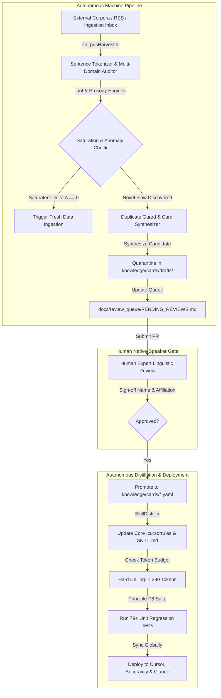

# Bhashabid Autonomous Learning & Continuous Growth Plan

## 1. Executive Vision
Bhashabid operates under a strict division of labor between machine automation and human linguistic governance:
- **Human Responsibility (Principle P2)**: Solely authenticating and signing off on candidate knowledge cards (`knowledge/cards/drafts/`) via GitHub Pull Requests or the CLI review tool.
- **Autonomous Machine Responsibility (100% Autonomous)**: Everything else—data harvesting, sentence tokenization, multi-domain linting, adversarial stress-testing, saturation detection, anomaly clustering, draft synthesis, duplicate prevention, and progressive distillation across AI IDEs.

---

## 2. Learning Curve & Convergence Mathematics

To prevent compute waste and infinite looping over identical text, Bhashabid evaluates batch learning using two mathematical indices:

### A. Sector Saturation Index ($S$)
For any sector $d$, saturation measures the ratio of recognized benchmark sentences and trapped canaries to total batch volume:
$$S_d = \frac{N_{\text{clean\_verified}} + N_{\text{canaries\_trapped}}}{N_{\text{total}}}$$

- **$S_d < 0.85$**: Active exploration. Model is actively discovering unmapped structures.
- **$S_d \ge 0.95$**: Saturation reached. All canonical sentences are clean and all known flaws are trapped.

### B. Novel Anomaly Discovery Velocity ($\Delta A$)
$$\Delta A_k = \frac{\text{Novel Anomalies Trapped in Round } k}{N_{\text{batch}}}$$

- **Diminishing Returns Criterion**: If $\Delta A = 0$ for $k \ge 3$ consecutive rounds on the same batch, the dataset is **mathematically exhausted**.

---

## 3. Practice Duration & Ingestion Schedule

| Phase | Duration / Rounds | Action | Autonomous Trigger |
| :--- | :--- | :--- | :--- |
| **Active Practice on Batch** | **3 to 5 rounds** (~2–5 minutes) | Audits 14 corpora + runs `AdversarialGenerator` perturbations. | Runs until $\Delta A = 0$ across 3 rounds. |
| **Saturation Trigger** | **Immediate** | Stops redundant practice on static batch. | Condition: Saturation $S \ge 0.95$ and $\Delta A = 0$. |
| **New Data Ingestion** | **Automated cycle** | Scans `eval/corpora/inbox/`, crawls RSS headlines, or escalates adversarial entropy. | Pulls next chunk of 50–100 unharvested sentences. |
| **Synthesis & Quarantine** | **Automated** | Clusters novel anomalies into candidate YAML cards in `knowledge/cards/drafts/`. | Checks Duplicate Guard; skips duplicates, writes novel patterns. |
| **Human Review** | **Asynchronous (Human)** | Community native speakers review PRs at `docs/review_queue/`. | Reviewer signs name & affiliation (P2). |
| **Distillation & Deployment** | **Automated (Upon Merge)** | Distills approved invariants into `.cursorrules`, runs P8 unit suite, verifies $< 390$ tokens. | Maintainer command: `python -m tools.cli distill`. |

---

## 4. Multi-Channel Autonomous Data Ingestion

To continuously master all 11 sectors, the engine ingests fresh data via four channels:

1. **Local Inbox Ingestion (`eval/corpora/inbox/`)**:
   - Any raw text, news archive, court judgment, or PDF dump dropped into this directory is automatically processed, split into sentences, and audited on the next practice cycle.
2. **Dynamic Adversarial Escalation (`AdversarialGenerator`)**:
   - When real-world text is clean, the generator synthesizes higher-entropy adversarial variants: multi-clause calques, pre-1992 spelling drifts, broken Unicode conjuncts, and Sadhu-Cholito mixtures.
3. **Automated News & Gazette Ingestion**:
   - Ingests public RSS feeds and press handouts from official sources (PID, Bangladesh Bank, Supreme Court cause-lists, NCTB syllabus updates).
4. **Bilingual Parallel Text Alignment**:
   - Audits English wire stories against raw LLM translations and human gold standards (e.g. `bdnews24_tbs_parallel.jsonl`) to isolate subtle translation calques.

---

## 5. Architectural Guardrails (Zero Compromise)

1. **Principle P2 (Human Gate)**: The machine NEVER self-approves candidate draft cards. They remain quarantined in `drafts/` until an authenticated human native speaker signs off.
2. **Token Ceiling Guard**: Core prompt rules must NEVER exceed **390 tokens** (currently **302 tokens**).
3. **Principle P8 (Zero Regression)**: All 79+ unit tests must pass 100% green before any distillation is deployed globally.
4. **Duplicate Guard**: All cards must have unique titles, rule summaries, and deduplicated examples across production and drafts.
